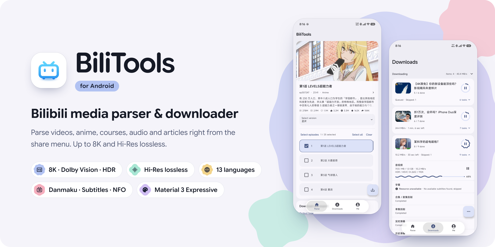
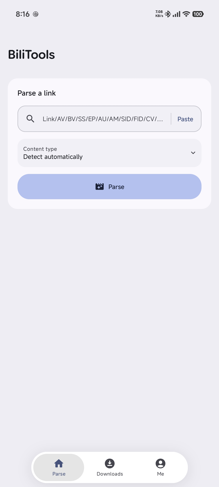
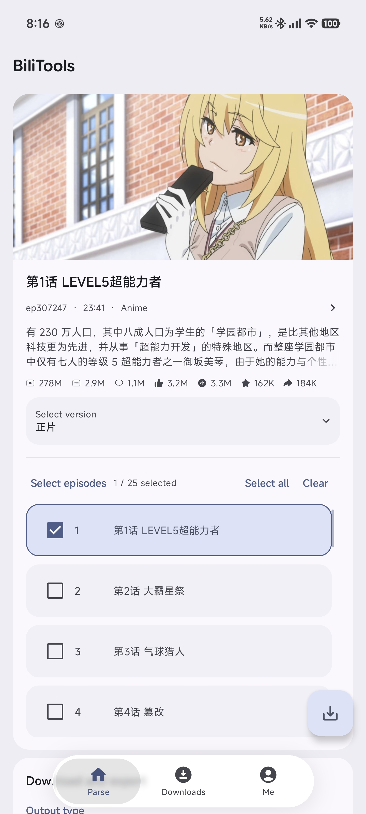
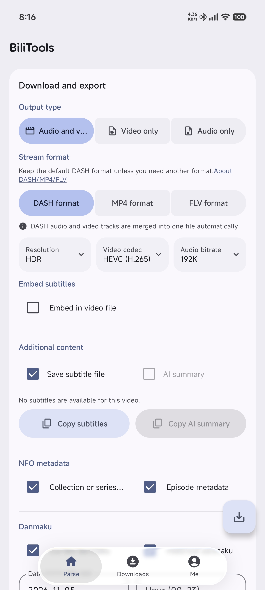
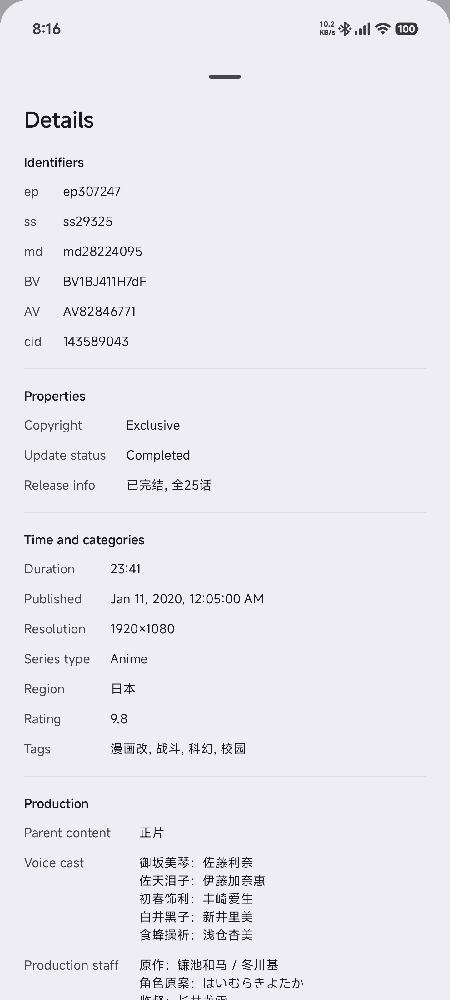
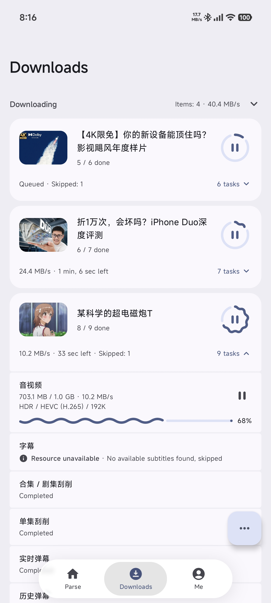
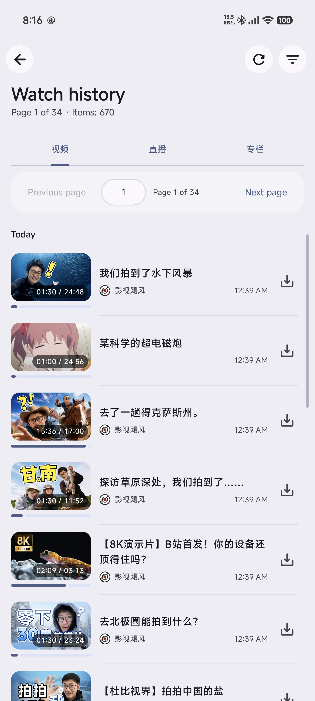
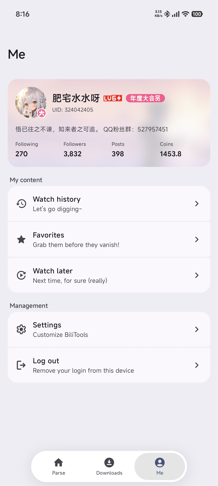
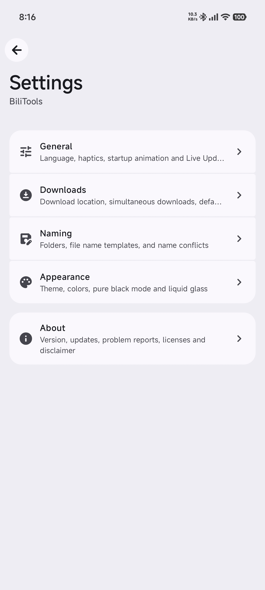
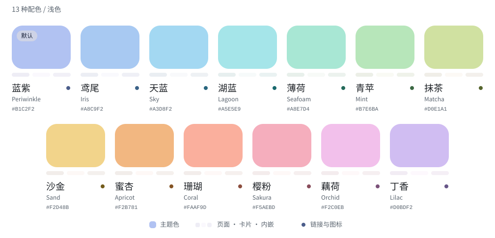

<div align="center">

<picture>
  <source media="(prefers-color-scheme: dark)" srcset="./docs/assets/banner/banner-en-dark.webp">
  
</picture>

<br/>
<br/>

<!-- Badge colors, in order: Periwinkle, Sakura, Seafoam, Lilac, Sky, and Mint. The left side uses the light theme's colorPrimary; the right side uses colorPrimaryFixedDim. -->
<p>
  <a href="https://github.com/happycola233/BiliTools/releases/latest"></a>
  <a href="https://github.com/happycola233/BiliTools/releases"></a>
  <a href="LICENSE"></a>
  <a href="https://kotlinlang.org"></a>
  <a href="https://m3.material.io/blog/building-with-m3-expressive"></a>
  <a href="https://www.android.com"></a>
</p>

<p>
  <a href="./README.md">简体中文</a> · <b>English</b>
</p>

<p>
  <a href="https://github.com/happycola233/BiliTools/releases/latest"><b>Download</b></a> ·
  <a href="https://github.com/happycola233/BiliTools/releases">Changelog</a> ·
  <a href="https://github.com/happycola233/BiliTools/issues">Report an issue</a>
</p>

</div>

BiliTools is a Bilibili media parser and downloader for Android. Choose **Share → BiliTools** in Bilibili or any other app, or paste a link, to parse videos, anime, courses, audio, and articles. Pick the quality you want, up to 8K, Dolby Vision, and Hi-Res lossless, and save subtitles, danmaku (scrolling comments), AI summaries, and NFO metadata along with your media. The interface combines Material 3 Expressive with liquid glass, and ships with 13 interface languages and 13 original color schemes. Free and open source.

## ✨ Highlights

- **Share to parse**: Choose **Share → BiliTools** in another app and parse and download from the quick panel, without switching apps.
- **Every kind of content**: Uploaded videos, anime and shows, courses, audio and playlists, articles and posts, favorites, Watch later, and creator profiles, with collection and batch downloads.
- **High-quality audio and video**: Up to 8K, Dolby Vision, and HDR, plus Hi-Res lossless and Dolby Atmos audio, with AVC, HEVC, and AV1 codecs.
- **Complete exports**: Subtitles, AI summaries, current and historical danmaku (XML / ASS), NFO metadata, covers and posters, and posts in Markdown. Titles, artists, covers, and other tags can be written into audio and video files.
- **13 interface languages**: Simplified Chinese, Traditional Chinese, English, Japanese, and more are built into the app and switch instantly. Arabic uses a right-to-left layout.
- **Material 3 Expressive × liquid glass**: 13 original color schemes plus dynamic color, with light, dark, and AMOLED pure black themes.
- **Your data stays on your device**: Login credentials, settings, and download records are stored locally. Diagnostic reports are never uploaded automatically; you preview them and decide whether to share.

<a id="screenshots"></a>

## 📸 Screenshots

> Screenshots automatically switch between light and dark versions to match your GitHub theme.

<table align="center">
  <tr>
    <td align="center"><b>Parse</b></td>
    <td align="center"><b>Anime and episodes</b></td>
    <td align="center"><b>Download and export</b></td>
    <td align="center"><b>Details</b></td>
  </tr>
  <tr>
    <td><picture><source media="(prefers-color-scheme: dark)" srcset="./docs/assets/screenshots/en/01-parse-dark.jpg"></picture></td>
    <td><picture><source media="(prefers-color-scheme: dark)" srcset="./docs/assets/screenshots/en/02-anime-dark.jpg"></picture></td>
    <td><picture><source media="(prefers-color-scheme: dark)" srcset="./docs/assets/screenshots/en/03-download-options-dark.jpg"></picture></td>
    <td><picture><source media="(prefers-color-scheme: dark)" srcset="./docs/assets/screenshots/en/04-details-dark.jpg"></picture></td>
  </tr>
  <tr>
    <td align="center"><b>Downloads</b></td>
    <td align="center"><b>Watch history</b></td>
    <td align="center"><b>Me</b></td>
    <td align="center"><b>Settings</b></td>
  </tr>
  <tr>
    <td><picture><source media="(prefers-color-scheme: dark)" srcset="./docs/assets/screenshots/en/05-downloads-dark.jpg"></picture></td>
    <td><picture><source media="(prefers-color-scheme: dark)" srcset="./docs/assets/screenshots/en/06-history-dark.jpg"></picture></td>
    <td><picture><source media="(prefers-color-scheme: dark)" srcset="./docs/assets/screenshots/en/07-me-dark.jpg"></picture></td>
    <td><picture><source media="(prefers-color-scheme: dark)" srcset="./docs/assets/screenshots/en/08-settings-dark.jpg"></picture></td>
  </tr>
</table>

<a id="installation"></a>

## 📦 Installation

Download the latest APK from [Releases](https://github.com/happycola233/BiliTools/releases/latest). Builds are available for `arm64-v8a`, `armeabi-v7a`, `x86`, and `x86_64`, plus a universal APK. **arm64-v8a** is recommended for most phones.

- **Requirements**: Android 10 (API 29) or later.
- **In-app updates**: Open **Settings → About → Check for updates** to download the APK for your device.

<a id="content-parsing"></a>

## 🔍 Content parsing

> [!TIP]
> **No need to open BiliTools separately or switch apps.** In Bilibili or another app, choose **Share → BiliTools** to parse and download content in the quick download panel.

You can also paste a link or enter an AV, BV, or other identifier in BiliTools, and select the content type manually.

| Supported input | Content |
|---|---|
| Content links from `bilibili.com` / `m.bilibili.com` / `space.bilibili.com`, or `b23.tv` short links, including links embedded in shared text | Automatically detects the content types below |
| `BV…` / `av…` | Uploaded videos, including videos with multiple parts and collaborative uploads |
| `ep…` / `ss…` / `md…` | Anime, films, and TV series; `cheese` links are automatically recognized as courses |
| `au…` / `am…` | Audio tracks and playlists |
| `cv…` / `opus` links / `rl…` | Articles, posts, and article collections |
| `uid…` / profile links | A creator's videos, posts, and audio, as well as collections and series on their profile |
| Favorites links / Watch later links | Favorites, with support for switching folders, or Watch later |

### Content information

Results show the cover, title, description, creator information and follower count, along with views, danmaku, comments, likes, coins, favorites, and shares. Long-press a title, description, cover link, or creator name to copy it.

Open **Details** to view and copy individual fields:

- **Identifiers**: AV / BV / CID / EP / SS / MD / UID and other content identifiers.
- **Content attributes**: Original or reposted content, free for a limited time, Premium membership exclusives, interactive videos, and more.
- **Basic information**: Category, video resolution, submission or approval time, publication time, official honors and rankings, tags, and the first frame of each video part.
- **Contributors**: The members of a collaborative upload and their roles.
- **Shows and courses**: Production regions, Bilibili ratings, voice cast, and production staff for anime, films, and shows; pricing and release status for paid courses.

<a id="downloads-and-exports"></a>

## 📥 Downloads and exports

### Audio and video quality and media formats

Choose video quality, audio quality, and any additional content to save in the download panel.

> [!IMPORTANT]
> Available quality options and additional content depend on the source video or audio and your account permissions. Log in to access the higher video and audio quality available to your account.

- **Output type**: Audio and video · Video only · Audio only. Video-only output shows resolution and codec options; audio-only output shows audio quality. Your selections are retained when you switch output types.
- **Stream format**: Audio and video output supports DASH (recommended), MP4, and FLV. Video-only and audio-only output use DASH, so there is no stream format to select.
- **Resolution and video quality**: 8K Ultra HD · Dolby Vision · HDR · 4K Ultra HD · 1080P 60 fps · 1080P high bitrate · 1080P HD · 720P · 480P · 360P · 240P.
- **Video codecs**: AVC (H.264) · HEVC (H.265) · AV1.
- **Audio quality**: Hi-Res lossless · Lossless FLAC · Dolby Atmos · 320K · 192K · 132K · 128K · 64K.
- **Batch quality settings**: Set a resolution and audio quality preference for an entire batch: highest, lowest, or a fixed quality level. If an item does not support the selected level, its highest available quality is used instead.

### Export additional content

- **Subtitles**: Choose languages or select all to export SRT files. Subtitles can also be copied as plain text.
- **AI summaries**: Export Bilibili's AI summaries as Markdown with section timestamps, or copy them with one tap.
- **Danmaku**: Export current danmaku or historical danmaku from a specified date in XML or ASS format. Historical danmaku requires login.
- **NFO metadata**: Save collection or series information as `tvshow.nfo`, or export NFO files for individual episodes. Titles, descriptions, dates, tags, covers, and other details help you organize a local media library.
- **Covers and posters**: Download covers, square covers, first frames, collection or season covers, landscape posters (16:10 / 16:9), and course previews.
- **Media tags**: Enable **Add metadata to downloaded files** in **Settings → Download** to automatically add titles, artists, albums, descriptions, years, tags, and covers to MP3, M4A, MP4, and FLAC files after downloading.

### Batch downloads and file processing

- **Collections and batch downloads**: Select anime and course episodes by season, version, or groups such as main episodes, trailers, and specials. Select multiple items from favorites, Watch later, playlists, article collections, and creator uploads. Favorites also support switching folders and paging. When parsing a video in a collection, enable **Collection mode** to select several episodes and download every part of each. Single-part videos use the upload title by default; videos with multiple parts use each part's title.
- **Articles and posts**: Save articles (`cv`), posts (`opus`), article collections (`rl`), and posts from creator profiles. The body is exported as Markdown, preserving the title, author, date, quotations, lists, code, formulas, and image placement. Images are saved at their original dimensions.
- **Format conversion**: Enable **Convert audio to MP3** or **Convert video to MP4** in **Settings → Download** to convert files automatically after downloading.
- **File names and folders**: Set folder and file name templates for each content type in **Settings → Naming**. See [Naming templates](#naming-templates).

> [!TIP]
> Choose AVC (H.264) for playback on a wider range of devices. Converting to MP4 keeps the original video codec and converts the audio to AAC.

### Download management

- **Task groups**: Downloads are grouped by content. Expand a group to see progress, speed, estimated time remaining, quality, and codecs, such as `4K Ultra HD / HEVC / 192K`. Processing stages include downloading, merging audio and video, transcoding, converting danmaku, and saving files.
- **Batch actions**: The floating menu lets you start all downloads, pause all downloads, clear completed records, clear all records, or manage selected tasks.
- **Open and share**: Open downloaded files in another app or share them with other apps.
- **Download notifications**: Track overall progress and pause or resume all downloads from the notification shade. On devices that support Android Live Update, enable live notifications in **Settings → General**.
- **Concurrency and storage**: Set the maximum number of simultaneous downloads (1–5) and the save location in **Settings → Download**. Files are saved to `Download/BiliTools` by default; you can choose another subfolder under Download.
- **Gallery visibility**: Enable **Hide downloaded videos from the system gallery** in **Settings → Download** to keep downloaded videos out of your gallery.

<a id="account-and-personal-content"></a>

## 👤 Account and personal content

- **Login methods**: Log in with a QR code, an account and password, or an SMS verification code. Logging in unlocks the higher video and audio quality available to your account.
- **Profile**: View your avatar, level (including hardcore membership), Premium membership status, bio, following, followers, posts, coins, and UID.
- **Favorites and Watch later**: Open **My favorites** or **Watch later** from the **Me** page to parse content and download it in batches.
- **History**: Browse by category (videos / live streams / articles) and time, with viewing progress. Search by keyword or filter by duration (from under 10 minutes to over 60 minutes), date range, and device (PC / phone / tablet / TV). Jump to a page or scroll to load more. Open video, anime, course, and article entries directly in the parsing screen; live stream history is available for browsing only.
- **Log out**: Login credentials are stored on your device. Logging out removes the local login state.

<a id="languages"></a>

## 🌐 Languages

The BiliTools interface is available in 13 languages. Switch between them in **Settings → General → Language**:

> 简体中文 · 繁體中文 · English · 日本語 · Español · Português · اللغة العربية · Русский · Türkçe · ไทย · Bahasa Melayu · Tiếng Việt · Bahasa Indonesia

- **Follows your system by default**: The app uses your system language on first launch. On Android 13 and later, you can also set it separately under **App languages** in system settings.
- **Instant switching**: Every language is included in the app, so there is no language pack to download. Changes apply immediately without restarting the app, and parsed content is kept.
- **Right-to-left layout**: In Arabic, spacing, alignment, back arrows, navigation animations, and the bottom bar's drag direction all mirror to follow the layout direction.
- **Original content stays as is**: Bilibili content such as video titles, descriptions, and categories, as well as saved file names, are not changed by the interface language.

<a id="settings"></a>

## ⚙️ Settings

- **General**: Choose the app language and haptic feedback level (Off / Light / Full), and turn Live Update notifications and the bouncing TV startup animation on or off. For the Live Update icon, choose BiliTools on a white circle (default) or a download arrow. Some systems apply a single tint to the notification card's icon, which can turn the BiliTools logo into a solid circle; choose the download arrow if this occurs.
- **Download**: Set the default resolution and audio quality (highest / lowest / fixed) and video codec. Adjust the maximum number of simultaneous downloads (1–5) and the save location. Configure file metadata, danmaku conversion to ASS, audio conversion to MP3, video conversion to MP4, confirmation before downloading over mobile data, and gallery visibility.
- **Naming**: Set **top-level folder, item folder, and file name** templates separately for **videos, shows and courses, music, and posts**. Set a top-level folder template for **lists**. Choose whether to create a top-level folder (Automatic / On / Off), overwrite existing names or append a number, remove extra separators, and number single-part videos.
- **Appearance**: Follow the system theme or choose light or dark mode. Use dynamic colors or one of thirteen built-in color schemes. Enable a pure black theme, switch the liquid glass bottom bar and panels independently, and adjust the bottom bar width.
- **About**: View the app version and check for updates. Updates select the right APK for your device from GitHub Releases, with mirror support for faster downloads. Generate a local diagnostic report, preview it, then share or save it. Report problems directly from failed downloads or after an unexpected exit. Diagnostic logs record app activity and errors to help investigate problems. They are kept for up to 7 days (3 MB maximum), with credentials, IP addresses and your account UID removed before storage. Nothing is uploaded automatically. Clear diagnostic logs, and view open-source licenses and the disclaimer.

<a id="naming-templates"></a>

<details>
<summary><b>Naming templates</b></summary>

<br/>

Naming templates support more than thirty variables and optional sections. The default file name template for uploaded videos is:

```text
{taskType} - {?(P{p}) }{title}{? - {res}}
```

- **Content variables**: `{title}`, `{work}`, `{collection}`, `{p}`, `{ep}`, `{section}`, and more.
- **Time variables**: `{pubtime:YYYY-MM-DD}`, `{downtime:ts}`, and more, with custom date formats or timestamps.
- **Identifiers and creators**: `{bvid}`, `{aid}`, `{cid}`, `{epid}`, `{upper}`, `{artist}`, and more.
- **Media parameters**: `{res}`, `{abr}`, `{enc}`, and `{fmt}` represent resolution, audio bitrate, video codec, and stream format.

If any variable inside `{? … }` is empty, the entire optional section is omitted, including its parentheses, spaces, and separators.

</details>

<a id="interface-design"></a>

## 🎨 Design: Material 3 Expressive × liquid glass

- **Material 3 Expressive**: Expressive themes and motion, including morphing loading indicators, connected button groups, expanding floating action menus, split buttons, and large headers that collapse as you scroll.
- **Liquid glass**: The bottom navigation uses transparency, blur, and refraction. Drag the selected tab to switch pages, and adjust the bar's width. Download open/share menus and batch management panels use the same glass effect. **Liquid glass bottom bar** and **Liquid glass panels** can be toggled independently in **Settings → Appearance**; both are on by default. Turning them off uses Material styling while preserving the panel layout. Devices below Android 13, or without hardware acceleration, automatically use Material styling. Solid panel backgrounds follow the color scheme, with subtle outlines in dark and pure black modes.
- **System integration**: Edge-to-edge display, predictive back gestures, and haptic feedback tailored to the type of interaction (Light / Full).
- **Playful startup animation**: A bouncing TV animation plays when the app launches. Turn it on or off in **Settings → General**.
- **Theme switching**: Light, dark, and pure black modes, with color changes applied immediately without restarting the app.

<a id="color-system"></a>

## 🌈 Color system

BiliTools uses a **soft, fresh, and bright** palette. Moderate saturation gives each scheme its character, while gentle fills and clear tonal layers keep light interfaces airy and dark interfaces clean, with readability in mind for longer browsing sessions.

<picture>
  <source media="(max-width: 600px) and (prefers-color-scheme: dark)" srcset="./docs/assets/palette-dark-mobile.svg">
  <source media="(max-width: 600px)" srcset="./docs/assets/palette-light-mobile.svg">
  <source media="(prefers-color-scheme: dark)" srcset="./docs/assets/palette-dark.svg">
  
</picture>

Choose from thirteen original Material 3 color schemes in **Settings → Appearance**. Each scheme covers buttons, backgrounds, cards, text, and borders in both light and dark modes.

**Sakura Pink** echoes Bilibili's pink with a softer, less saturated shade that complements the subtle page backgrounds. **Periwinkle** builds on the blue-gray tones of Android 16's default Monet palette and is available for anyone who prefers that look.

[Dynamic color](https://developer.android.com/develop/ui/compose/designsystems/material3#dynamic_color) is on by default. On Android 12 and later, it lets the interface follow your system wallpaper colors. Turning it off restores the last built-in scheme you selected, or **Periwinkle** if you have never selected one. Switching colors does not change the layout; dynamic color values are provided by the system.

<details>
<summary><b>Color design details</b></summary>

<br/>

The built-in schemes share consistent tonal layers and readability:

- **Soft fills that stay consistent across light and dark modes**: Primary buttons, selected capsules, and active slider tracks use bright theme colors with moderate saturation, keeping them light even in light mode. These fills retain the same color across light and dark themes and match the swatches in Settings, using the `primaryFixedDim` color role. Lightness is adjusted using the largest sRGB channel, with limits on chroma and lightness to balance the visual intensity of warm and cool colors.
- **Distinct background layers**: Pages, cards, nested surfaces, and active states use lightness differences within the same hue. Light pages have only a slight tint, cards use soft near-white colors, and nested surfaces retain a subtle tone, separating layers without looking gray or dull. Dark backgrounds use less tint to avoid unwanted color casts in shadows.
- **Readable text and subtle borders**: Body and secondary text in light mode are dark enough to remain clear on soft backgrounds. They use HCT tones T10 and T30, with contrast ratios against card backgrounds of approximately 16:1 and 8.9:1. Fine borders use T80, keeping 1 dp outlines visible without making them prominent.
- **Error colors**: Every scheme uses the baseline Material 3 error palette. In light mode, actions such as deletion use a pale red background that is easy to recognize and fits the rest of the interface.
- **Pure black theme**: Dark pages use a `#000000` background, while cards and nested surfaces retain dark gray layers for AMOLED screens. This works with either built-in schemes or dynamic colors.

The built-in schemes are generated with the official [Material Color Utilities](https://github.com/material-foundation/material-color-utilities), using the Tonal Spot scheme from the Material 3 Expressive 2025 specification, then adjusted for fills, background layers, and text contrast. The base colors are checked against Android 16's default Monet palette; Periwinkle uses its seed hue of 269°.

The generator, regression checks for contrast, layer separation, and role consistency, and design notes are in [`docs/配色系统/`](./docs/配色系统/README.md).

</details>

<a id="building"></a>

## 🛠️ Building

Requires JDK 17 or later and Android SDK Platform 37. Gradle resolves dependencies automatically.

```bash
git clone https://github.com/happycola233/BiliTools.git
cd BiliTools
./gradlew assembleDebug
```

On Windows, use `gradlew.bat assembleDebug`.

| Area | Core technologies and libraries |
|---|---|
| Language and architecture | Kotlin 2.4 · Jetpack Compose 1.12 · Material 3 1.5.0-alpha27 (Expressive) · Navigation 3 |
| Networking and data | OkHttp 5 · Moshi · Coil 3 |
| Media processing | FFmpeg-Kit 6.1 for merging, transcoding, and muxing · JAudiotagger 3 for media tags · Built-in danmaku parsing and ASS conversion |
| Interface effects | Backdrop for liquid glass blur · Material Color Utilities for palette generation |
| Target platform | minSdk 29 · targetSdk 36 · compileSdk 37 |

## 🙏 Acknowledgments

- [btjawa/BiliTools](https://github.com/btjawa/BiliTools): BiliTools for desktop, the reference for this app's feature behavior.
- [SocialSisterYi/bilibili-API-collect](https://github.com/SocialSisterYi/bilibili-API-collect): A community-maintained collection of Bilibili APIs.
- [Kyant0/AndroidLiquidGlass](https://github.com/Kyant0/AndroidLiquidGlass): The liquid glass effect (Backdrop).
- [JamaisMagic/ffmpeg-kit-16KB](https://github.com/JamaisMagic/ffmpeg-kit-16KB): FFmpegKit builds with 16 KB page size support.
- [material-foundation/material-color-utilities](https://github.com/material-foundation/material-color-utilities): Material color generation.

## ⚠️ Disclaimer

- **Local data**: Login credentials, settings, and download records are stored in plain text on your device. The app does not provide cloud synchronization for this data. Keep your device and exported files secure.
- **User responsibility**: Users are solely responsible for any consequences of using this project. The developers bear no responsibility.
- **Trademarks**: The names “哔哩哔哩” and “Bilibili,” their logos, and associated graphics are registered trademarks or trademarks of Shanghai Huandian Information Technology Co., Ltd. (上海幻电信息科技有限公司). This project has no affiliation, partnership, authorization, or endorsement from Bilibili or its affiliates.

## 📜 License

This project is open source under the [GPL-3.0-or-later](LICENSE) license.
